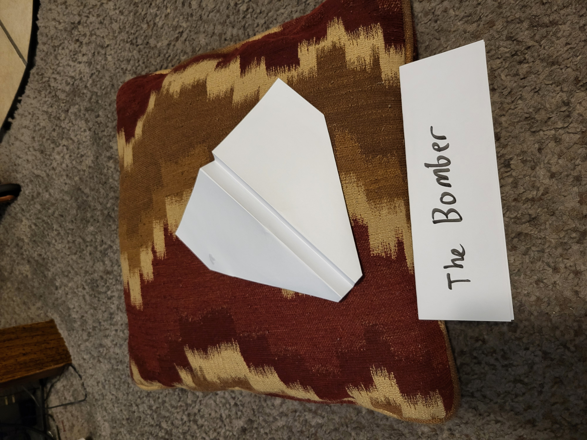
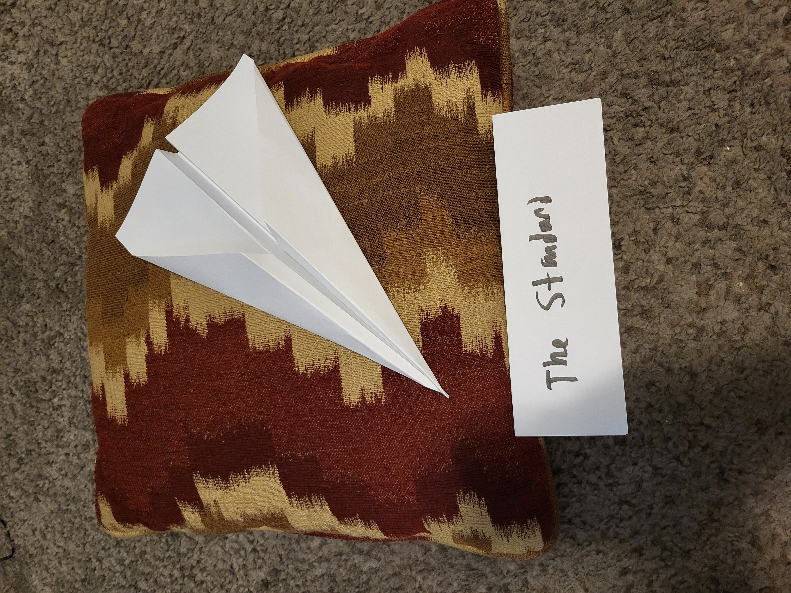
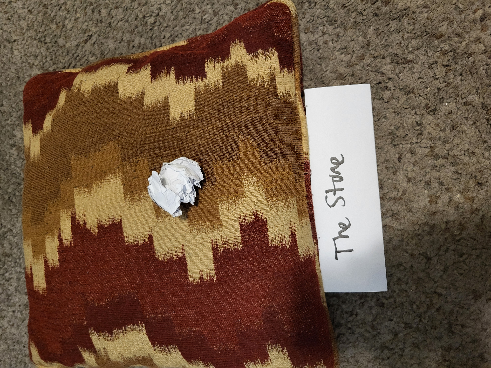
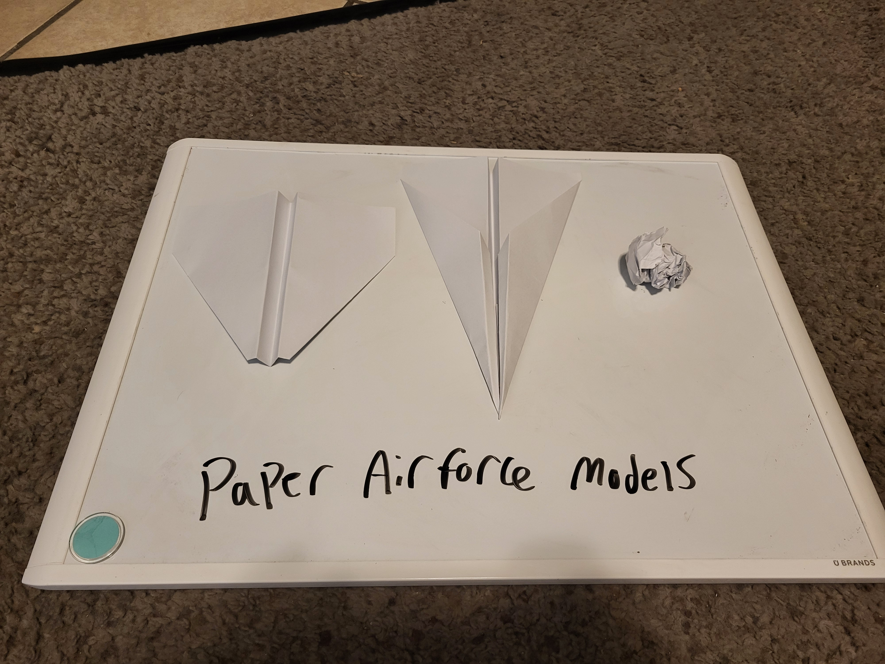

```{r Set Up Chunk, warning=FALSE, message=FALSE}
library(tidyverse)
library(mosaic)
library(car)
library(emmeans)
library(pander)
library(DT)

data1 <- read_csv("../data/plane_data.csv")

data1 <- data1 %>%
  mutate(thrower = "My Wife")

data2 <- read_csv("../data/plane_data_ethan.csv")

data2 <- data2 %>%
  mutate(thrower="Me")

data <- bind_rows(data1, data2)
```

# Executive Summary
This study investigated whether paper airplane design, thrower, or the interaction between design and thrower influenced average throwing distance. A two-way ANOVA was conducted to evaluate these factors. The results showed no statistically significant differences in average throwing distance among the three airplane designs or among the different throwers. Additionally, there was no statistically significant interaction between airplane design and thrower, suggesting that the effect of airplane design on throwing distance did not significantly depend on who threw the plane. Therefore, we failed to reject the null hypotheses. Based on these results, there is insufficient statistical evidence to conclude that airplane design, thrower, or their combination affects average throwing distance.

## Study Design 
### Design Overview 

**Objective**: Determine which of three paper airplane designs (Bomber, Standard, Stone) go the farthest distance when thrown. Further divided by the skill of the thrower (Me and my Wife)

**Population**: 15 Paper Airplanes

**Response Variable**: Distance in feet

**Treatment Factor**: Folding Design / Thrower

**Experimental Unit**: Type of Design / Thrower

**Observational Unit**: Each Paper Airplane

#### Randomization
We have employed the following Randomizations:

**Random Selection of Experimental Units:** The sheets of paper used for the experiment were randomly selected from the available paper.

**Random Assignment of Units to Treatment:** The sheets of paper were randomly assigned to one of the three airplane designs: *Bomber*, *Standard*, or *Stone*. The order in which the planes were folded was also randomized.

**Random Order of Experimental Runs:** The order in which the completed airplanes were thrown was randomized. This helped prevent factors such as changes in throwing ability or fatigue from favoring one particular design.

### Factors

#### Controlled - Varied
- Airplane design
- Thrower of teh airplanes

#### Controlled - Held Constant
- Where the planes were thrown (The Hinkley Gym)
- Type of Paper (A4 print paper)
- Standing position 
- Folder of the airplanes (Me)

#### Not Controlled - Measured
- None

#### Not Controlled - Not Measured
- Ac cause air movement
- Strength of the throw

### Types of Planes

#### The Bomber
{width=30%}

The Bomber is a plane I made most commonly when I was a child. It is the coolest looking of the three

#### The Standard
{width=30%}

This is a standard paper airplane that children first learn to make. 

#### The Stone
{width=30%}

This is the plane my dad used to win a paper airplane contest when I was a child. There is considerable discourse on whether or not this qualifies as a plane. I am on the side of the supporters.

#### All together

##### All models
{width=30%}

All Paper Airplane models side by side

### Hyposthesis

$$
\text{Level of Significance}=0.05
$$

#### Plane Design

$$
H_0: \alpha_\text{Bomber} = \alpha_\text{Standard} = \alpha_\text{Stone} = 0
$$

$$
H_a: \alpha_\text{At Least One} \neq 0
$$

Our Null Hypothesis states that the design of the plane has no effect on the distance thrown. I.E. that the $\alpha$ is 0 for each level.  

Our Alternative Hypothesis states that at least one design will have a different average distance when thrown than the others.

#### Thrower

$$
H_0: \beta_\text{Me} = \beta_\text{my wife} = 0
$$

$$
H_a: \beta_\text{Me} \neq \beta_\text{my wife}
$$

Our Null Hypothesis states that the thrower of the plane has no effect on the distance thrown. I.E. that the $\beta$ is 0 for both levels.  

Our Alternative Hypothesis states that  one thrower will have a different average distance when thrown than the others.

## Data Collection
We collected our data by throwing the 15 paper airplanes in an empty gymnasium at the BYUI University as it was the most controlled environment available to us at the time. my wife threw her planes for an earlier experiment (Case Study 1). I threw his at a different time with the same randomizations and experiment structure. We measured how far each plane flew and recorded the data in feet.

## Descriptive Stats

```{r favstats}
favstats(dist ~ type | thrower, data=data) %>% pander()
```

```{r boxplot}
ggplot(data, aes(x = type, y = dist, fill = thrower)) +
  geom_boxplot() +
  labs(
    title = "my wife Has Consistently Wider Ranges",
    x = "Airplane Design",
    y = "Distance (feet)"
  ) +
  theme_minimal(base_size = 14) +
  scale_fill_manual(values = c("firebrick","skyblue"))
```

## Interaction

```{r interaction}
interaction.plot(
  x.factor = data$type,
  trace.factor = data$thrower,
  response = data$dist
)
```

This graph seems to indicate that there will be a significant interaction by the crossing of lines. To verify this we will need to run the ANOVA Model.

## Analysis {.tabset .tabset-pills}
### The Model {.tabset .tabset-pills}

$$
\underbrace{Y_{ijk}}_\text{Distance Flown} = \mu + \underbrace{\alpha_i}_\text{Type of Plane} + \underbrace{\beta_j}_\text{Thrower} + \underbrace{(\alpha\beta)_{ij}}_\text{Interaction} + \epsilon_{ijk}
$$

```{r anova}
myaov <- aov(dist~type*thrower, data=data)
summary(myaov) %>% pander()
```

There is, to my surprise, no significance to either the interaction nor the variables. This means that neither the thrower nor the type of plane had an statistically significant effect on the distance flown.

#### Type of plane

```{r  graph results, warning=FALSE, message=FALSE}
ggplot(data, aes(x = type, y = dist, color = type)) +
  geom_point() +
  stat_summary(fun = mean, geom = "point", size = 4) +
  stat_summary(fun = mean, geom = "line", aes(group = 1), linewidth = 1) +
  stat_summary(
    fun.data = mean_cl_normal,
    geom = "errorbar",
    width = 0.15,
    linewidth = 0.8
  ) +
  labs(
    title = "The average distance changes by airplane are not significant",
    x = "Airplane Design",
    y = "Mean Distance (feet)"
  ) +
  theme_minimal(base_size = 14)
```

#### Thrower of plane

```{r  graph results 2, warning=FALSE, message=FALSE}
ggplot(data, aes(x = thrower, y = dist, color = thrower)) +
  geom_point() +
  stat_summary(fun = mean, geom = "point", size = 4) +
  stat_summary(fun = mean, geom = "line", aes(group = 1), linewidth = 1) +
  stat_summary(
    fun.data = mean_cl_normal,
    geom = "errorbar",
    width = 0.15,
    linewidth = 0.8
  ) +
  labs(
    title = "The average distance changes by thrower are not significant",
    x = "Airplane Thrower",
    y = "Mean Distance (feet)"
  ) +
  theme_minimal(base_size = 14)
```


#### Interaction

```{r graph results 3, warning=FALSE, message=FALSE}
ggplot(data, aes(x = type, y = dist, color = thrower,
                 group = thrower)) +
  geom_point() +
  stat_summary(fun = mean, geom = "point", size = 4) +
  stat_summary(fun = mean, geom = "line", linewidth = 1) +
  stat_summary(
    fun.data = mean_cl_normal,
    geom = "errorbar",
    width = 0.15,
    linewidth = 0.8
  ) +
  labs(
    title = "Interaction Between Airplane Design and Thrower",
    x = "Airplane Design",
    y = "Mean Distance (feet)",
    color = "Thrower"
  ) +
  theme_minimal(base_size = 14)
```


### Assumptitions

```{r assumptions}
par(mfrow=c(1,3))
plot(myaov, which=1)
qqPlot(myaov$residuals, id=FALSE)
plot(myaov, which=3)
```

```{r levene test, warning=FALSE}
leveneTest(dist ~ type, data = data) %>% pander()
```


- **Constant Variance** Due to both the Levene's Test and the Residual's Vs Fitted plot **This assumption is NOT violated**
- **Normal Errors** The QQplot shows that **This assumption is NOT violated**
- **Independent Observations** The order plot, plus common sense tell us that **This assumption is NOT violated**

In summary **NO ASSUMPTIONS WERE VIOLATED**

# Conclusion 
In conclusion, the ANOVA results showed no statistically significant difference in average throwing distance among the three paper airplane designs nor among different throwers nor any significant interaction. Therefore, we failed to reject the null hypothesis. 